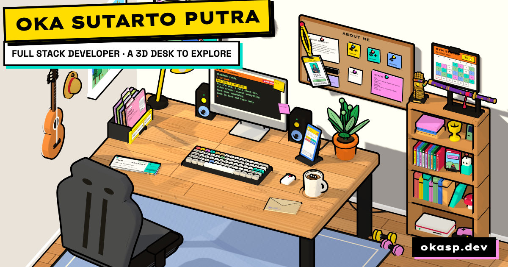

<div align="center">

# 🖥️ THE DESK

**Oka Sutarto Putra's portfolio, as a 3D desk you can explore.**

Click anything. Just don't try to use the Infinity Gauntlet. 🫰

[**okasp.dev**](https://okasp.dev) · [2D version](https://okasp.dev/2d)




</div>

---

## What is this?

Instead of scrolling through sections, you look around a room. Every part of the portfolio is a
prop on or around the desk: zoom into it, and it does its thing. The whole room is one
[Three.js](https://threejs.org) scene in a flat, neo-brutalist style: toon shading, thick black
outlines and hard shadows.

Prefer a classic page? The same content lives at [`/2d`](https://okasp.dev/2d).

## Things to click

| Prop | What it does |
| --- | --- |
| 🪪 **ID badge** | Flips to reveal the links. Drag its pin to re-pin it anywhere on the wall, or pull the lanyard and let it swing. |
| 📌 **About board** | Notes about me, pinned up. Drag them around and they pin back in place. |
| 🖥️ **Monitor** | A working terminal. Type `help`, `whoami`, `projects`, or `sudo hire oka`. |
| ⌨️ **Keyboard** | Every key on your keyboard presses the same key on the desk. Keys `1`–`5` jump between sections. |
| 🗂️ **Drawer** | Project files: flip through the tabs, pull one out and turn its pages. |
| 🎫 **Boarding passes** | My experience, one pass per job. Hold one up, flip it for the itinerary. |
| 📱 **Phone** | Chat with my AI twin (answers come from my CV, streamed). |
| ✉️ **Envelope** | A postcard to write and send. It really sends. |
| ☕ **Mug** | A sip and a quote. Finish the cup and the room switches to the night shift. |
| 💡 **Lamp** | Day and night, by hand. |
| 🔊 **Speakers** | Sound on or off, with a little groove when it comes on. |
| 🪟 **Window** | An animated landscape outside: birds by day, stars and fireflies by night. |
| 🪴 **Plant** | Each click blooms a flower. Three blooms call a butterfly. |
| 🖱️ **Mouse** | Grows ears and a tail, and scampers off for a lap. |
| 🪑 **Chair** | Spins. Obviously. |
| 🖼️ **Painting** | A small gallery: it flips to the next picture. |
| 🕰️ **Clock** | Spins its hands round and chimes. |
| 🎸 **Guitar** | Strums the next chord. |
| 👒 **Straw hat** | Luffy has something to say. |
| ⚔️ **Katana** | Drawn from its scabbard, a slash, a technique shouted, sakura falling. |
| 🏋️ **Dumbbells & calendar** | Count reps (ten is a PR) and stamp today on the gym streak. |
| 🧤 **Infinity Gauntlet** | Please don't. |

## Under the hood

- **No image or audio files for the room.** Every printed surface (the terminal, the notes, the
  boarding passes, the window view, the paintings) is drawn on a `<canvas>` at runtime, and every
  sound is synthesized live with the Web Audio API: plucked strings, a slurp, a paper riffle, a
  finger snap.
- **Outlines in screen space.** A small shader pushes each prop's back faces out by a fixed number
  of pixels, so lines stay the same weight whether the camera is pulled back or zoomed right in.
- **Camera shots.** Each prop defines where the camera looks from and the box it must fit; GSAP
  flies between them. Close-ups clip whatever stands in front so nothing blocks the view or the
  click.
- **Sharp at any zoom.** The renderer follows the device's pixel ratio, including browser and pinch
  zoom.
- **A real first load.** An animated loader is painted with the HTML before any JavaScript runs,
  then fades straight into the room.

## Tech stack

| Area | Tools |
| --- | --- |
| Front end | Vue 3, Vue Router, Tailwind CSS, VueUse |
| 3D & motion | Three.js, GSAP |
| Sound | Web Audio API (synthesized, no files) |
| Contact | EmailJS |
| AI chat | Node.js + Express API (`my-portfolio-api/`), OpenAI, server-sent events |
| Hosting | Vercel |

## Getting started

Needs a recent Node.js (it's developed on Node 22).

```bash
git clone https://github.com/okasutarto/the-desk.git
cd the-desk
npm install
npm run dev
```

The site runs at `http://localhost:8080`: the desk at `/`, the classic page at `/2d`.

### The AI chat (optional)

The phone and the 2D chatbot talk to a small API in `my-portfolio-api/`.

```bash
cd my-portfolio-api
npm install
echo "OPENAI_API_KEY=sk-..." > .env
node index.js            # listens on port 3000
```

Point the site at it with `VUE_APP_API_URL` in a `.env` at the project root (it defaults to
`http://localhost:3000`).

## Scripts

| Command | What it does |
| --- | --- |
| `npm run dev` | Development server with hot reload |
| `npm run build` | Production build into `dist/` |
| `npm run lint` | ESLint |
| `node scripts/check-*.cjs` | Quick logic checks for the desk: layout and camera framing, audio unlock, the coffee and night shift, the project files and postcard, the lighting |

## Project structure

```
the-desk/
├── public/
│   ├── index.html                # Meta tags and the boot loader
│   └── og-image.png              # Link preview image
├── src/
│   ├── views/
│   │   ├── DeskPage.vue          # The 3D desk: HUD and hints around the scene
│   │   └── HomePage.vue          # The classic 2D page at /2d
│   ├── components/
│   │   ├── features/desk/
│   │   │   ├── deskScene.js      # The whole room: props, interactions, camera shots
│   │   │   └── textures.js       # Everything printed on a canvas
│   │   ├── sections/             # 2D page sections
│   │   └── features/             # Chatbot, file drawer, theme switch, …
│   ├── composables/useSfx.js     # The synthesized sound effects
│   ├── data/                     # About notes, experience, projects (shared by 2D and 3D)
│   └── router/
├── my-portfolio-api/             # Express API for the AI chat
└── scripts/                      # Logic checks for the desk
```

The content lives in `src/data/`, and both the 2D page and the desk read from it, so editing a
project or a job updates both.

## Fan touches

The straw hat, the Enma-style katana and the Infinity Gauntlet are fan tributes to *One Piece* and
Marvel. Those characters, names and designs belong to their owners.

## Contact

**Oka Sutarto Putra** · Full stack developer, Pontianak 🇮🇩

[okasp.dev](https://okasp.dev) · [LinkedIn](https://linkedin.com/in/okasutarto) ·
[GitHub](https://github.com/okasutarto) · okasputra@gmail.com
