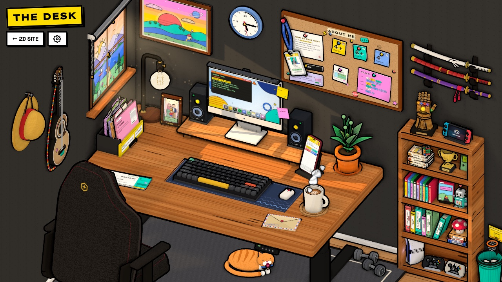
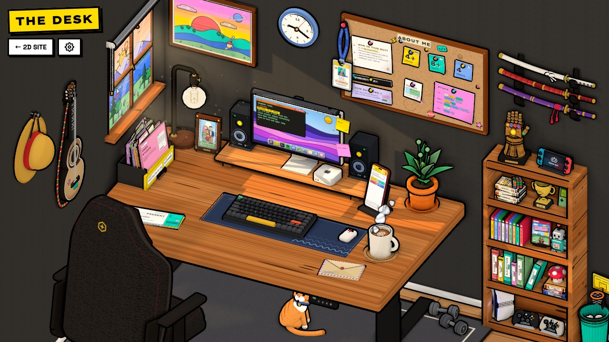
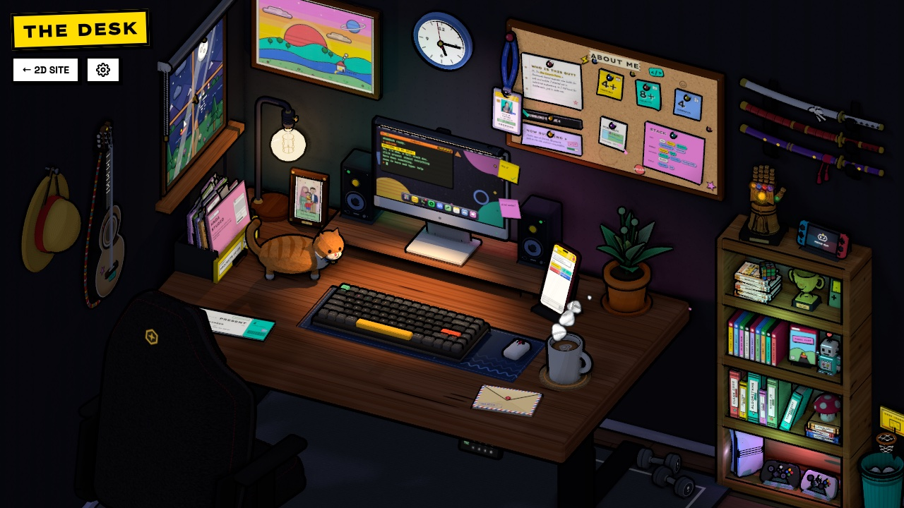

<div align="center">

# 🖥️ THE DESK

**Oka Sutarto Putra's portfolio, as a 3D desk you can explore.**

Click anything. Play a game on the console. Repaint the walls. Just don't try to use the Infinity Gauntlet. 🫰

[**okasp.dev**](https://okasp.dev) · [2D version](https://okasp.dev/2d)




</div>

---

## What is this?

Instead of scrolling through sections, you look around a room. Every part of the portfolio is a
prop on or around the desk: zoom into it, and it does its thing. The whole room is one
[Three.js](https://threejs.org) scene in a flat, neo-brutalist style: toon shading, thick black
outlines and hard shadows.

Prefer a classic page? The same content lives at [`/2d`](https://okasp.dev/2d).

### ✨ At a glance

- 🧭 **30-odd props to poke**, with close-ups, sounds and 20 hidden discoveries around the room
- 🖥️ **A real little desktop** on the monitor: dock, terminal, music player, Snake and an AI chat
- 🏴‍☠️ **A whole shoot-'em-up** on the console: *Straw Hat Strike*, Going Merry vs. the Marines
- 🌦️ **A living room**: morning to moonlight, rain, neon and a sleepy cat
- 🎨 **Make it yours**: repaint the walls, swap the wood and the grain of the furniture
- 📱 **Phone-friendly**: a pocket diorama you pinch, pan and turn
- 🖌️ **Painted in code**: the props' surfaces are canvas textures, and the music and guitar are synthesized

## Things to click

| Prop | What it does |
| --- | --- |
| 🪪 **ID badge** | Flips to reveal the links. Drag its pin to re-pin it anywhere on the wall, or pull the lanyard and let it swing. |
| 📌 **About board** | Notes about me, pinned up. Drag them around and they pin back in place. |
| 🖥️ **Monitor** | A tiny desktop with a draggable dock: a working terminal (`help`, `whoami`, `projects`, `sudo hire oka`), the Spotifree lo-fi player, VS Kode, Snake, a picker of six cut-paper wallpapers and more. |
| ⌨️ **Keyboard** | A Halo75 V2-inspired board with sculpted keycaps, a ribbed lower shell and a tilted chassis. Physical keys animate their matching modeled keys; `1`–`5` jump between sections. |
| 🖥️ **Mac mini** | Powers the monitor desktop off or starts its boot sequence, with a green power LED and startup chime. |
| 🗂️ **Drawer** | Project files: flip through the tabs, pull one out and turn its pages. |
| 🎫 **Boarding passes** | My experience, one pass per job. Hold one up, flip it for the itinerary. |
| 📱 **Phone** | Chat with my AI twin (answers come from my CV, streamed, and it remembers the last few turns). |
| ✉️ **Envelope** | A postcard to write and send. It really sends. |
| ☕ **Mug** | A sip and a quote. Finish the cup and the room switches to the night shift. |
| 💡 **Lamp** | Day and night, by hand. |
| 🔦 **Monitor lightbar** | Toggle the task light on or off during the night shift. |
| 🔊 **Speakers** | Sound on or off, with a little groove when it comes on. |
| 🪟 **Window & blind** | Morning, midday, sunset and moonlight scenery with birds, stars and rain. Pull the blind or its chain; three quick knocks toggle rain. The weather card shows live Pontianak weather when available. |
| 🪴 **Plant** | Each click blooms a flower. Three blooms call a butterfly. |
| 🖱️ **Mouse** | Grows ears and a tail, and scampers off for a lap. |
| 🪑 **Chair** | A Titan Evo-inspired gaming chair, traced from photos. Click to spin it, or drag it round on its post. |
| 🖼️ **Painting** | A small gallery: it flips to the next picture. |
| 🕰️ **Clock** | Spins its hands round and chimes. |
| 🎸 **Guitar** | Strums the next chord; its strings react to hover and vibration, and respond to the room lighting. |
| 👒 **Straw hat** | Luffy has something to say. |
| ⚔️ **Sword rack** | Inspect three swords, draw one and strike, with technique cards, manga effects and falling sakura. Its close-up has an independent spotlight. |
| 🏋️ **Dumbbells & calendar** | Count reps (ten is a PR) and stamp today on the gym streak. |
| 🧤 **Infinity Gauntlet** | Please don't. |
| 🎮 **Game shelf & console** | Explore the collection and power the console: the monitor becomes a TV running **Straw Hat Strike**. Drag vertically to browse the shelf. |
| 🤖 **Robot** | A small animated companion on the shelf. |
| 🐈 **Oyen** | An animated desk cat that watches, settles and reacts to activity around the room. |
| 🗑️ **Wastebasket** | Crumple papers and throw them into the basket. |
| 🏆 **Secrets trophy** | Tracks 20 discoveries and celebrates when the collection is complete; click it to replay the celebration. |

## 🏴‍☠️ Straw Hat Strike

Switch on the console on the shelf and the monitor turns into a TV. *Straw Hat Strike* is a
side-scrolling shoot-'em-up in the room's toon style: sail the Going Merry against Marine
gunboats, frigates and gulls, fire Gomu Gomu no Pistol, grab meat to power up, and save the
Gatling to clear the sky. A Sea King surfaces at the end of every stage.

| Play with | |
| --- | --- |
| ⌨️ Keyboard | Arrows / WASD to sail · Space for the Gatling · Q to quit |
| 🖱️ Mouse | The ship follows the pointer |
| 👆 Touch | Drag anywhere to sail · the red button fires the Gatling |
| 🎮 Gamepad | A real controller works too |

Chain kills for a multiplier, and if you go down you get your own wanted poster.

## 🎨 Make it your room

The ⚙️ gear next to **2D site** opens the room settings. Every pick applies instantly, by day
and by night, and is remembered in your browser.

| Part | Choices | Default |
| --- | --- | --- |
| 🧱 **Wall** | Seven house paints from white to graphite, or any colour at all | Graphite |
| 🪵 **Desk** | Six woods × four cuts | Cherry, butcher block |
| 🖥️ **Monitor riser** | Six woods × four cuts | Cherry, cathedral |
| 🪟 **Window frame** | Six woods × four cuts | Cherry, planks |
| 🎮 **Game shelf** | Six woods × four cuts | Cherry, planks |

**Woods:** Oak · Maple · White ash · Cherry · Walnut · Ebony stain
**Cuts:** Planks · Cathedral · Knotty · Butcher block

The grain is painted on a canvas at runtime, so every combination is drawn on the fly: no
texture files.

## 📱 On your phone

On a portrait screen the room becomes an isometric **diorama**: walls cut away just past the
furniture, standing on a thick slab on a dotted backdrop.

- **Pinch** (or Ctrl + scroll on a trackpad) to zoom around your fingers
- **Drag** to pan once zoomed in
- **Swipe sideways** to turn the diorama
- **Tap** any prop for its close-up; hints speak in taps, not keys

## Light, weather and atmosphere

**Same desk. A different mood.** Sunlight moves across the room, rain rolls in, and the
night shift trades the daylight for cyan and pink neon.

<table>
  <tr>
    <td width="50%"></td>
    <td width="50%"></td>
  </tr>
  <tr>
    <td align="center"><strong>☀️ Morning</strong><br />Warm wood, window light and crisp shadows.</td>
    <td align="center"><strong>🌙 Night shift</strong><br />Neon, a glowing screen and a quiet desk lamp.</td>
  </tr>
</table>

| ☀️ Morning | 🌤️ Midday | 🌇 Evening | 🌙 Night |
| --- | --- | --- | --- |
| Warm light across the monitor | Brighter room, steeper sunlight | Low amber light, muted violet shade | Moonlight, cyan/pink LEDs and a task light |

- **Watch the weather.** Rain fades in with its own ambience. Sunlight dims, its edges soften,
  and the view turns cloudy. Three quick knocks on the window toggle the rain.
- **Follow the light.** The sun and moon in the window guide the direct beam. Pull the blind
  and the light changes with it; the rear desk and monitor LEDs bring colour after dark.
- **Stay for the night shift.** The room changes phase every 20–30 seconds with a 2-second
  transition. Click the lamp or finish your coffee to switch the theme yourself.

<details>
<summary><strong>🔦 How the lighting works</strong></summary>

The painted sky and direct window light share celestial coordinates. A projected aperture,
glazing-bar occluders and the blind keep that beam inside the window opening. Rain attenuates
it more than the diffuse fill and softens its shadows.

Broad, overlapping light samples approximate the desk and monitor LED strips; the monitor
sources follow its movement. Shelf lighting is independent. A dim point light sits inside the
exposed bulb, while the monitor lightbar illuminates the work surface.

GTAO at CSS-pixel resolution and contact shadows give objects depth in every phase. The AO is
composited onto the higher-density frame. A broad shadowed
room fill complements the direct lights, and PCSS softens cast shadows with separation. This
is an artistic diorama setup, rather than a physical daylight or global-illumination simulation.

</details>

## Under the hood

**A little room, built out of code.** The printed details, moving props and small sounds are
part of the scene, not a video playing behind the page.

| | What makes it work |
| --- | --- |
| 🎨 **Drawn at runtime** | Canvas textures paint the notes, tickets, terminal, landscape, artwork and every wood grain. The portrait uses a supplied image. |
| 🎛️ **Synths and recorded detail** | Web Audio synthesizes guitar chords, UI sounds and the lo-fi player; short `.m4a` samples add steel, paper, object impacts and swallowing, with synthesized fallbacks. |
| ✒️ **Lines that stay sharp** | Screen-space outlines keep their weight as you zoom in. Rendering follows device density, up to 3×. |
| 🎬 **Every prop gets a close-up** | GSAP moves between framed camera shots; foreground props clip out of the way so they don't block the view or clicks. |
| 🧩 **Small things, shared draws** | Compatible toon meshes and simpler shadow proxies are batched. Original meshes still handle picking and animation. |
| 🚪 **The room starts before the scene** | An HTML boot loader appears before JavaScript, then fades into the desk. |

Audio respects the shared mute setting. The app tries to start Web Audio automatically;
when the browser blocks autoplay, a user gesture unlocks it. Recorded layers and their
licenses live in `public/sfx/`; the lo-fi music is generated in the browser.

<details>
<summary><strong>⚙️ Rendering details and tradeoffs</strong></summary>

- **Stable sharpness.** The main scene and final composite follow the canvas resolution;
  GTAO runs at CSS-pixel resolution and is blended up. Slow frames do not lower image density.
  Active camera moves and interactions follow browser frames.
- **Reuse work while idle.** AO and shadow maps are cached and refreshed on schedules, with
  more frequent updates while things move. Unsupported batching falls back to original meshes.
- **Keep material detail visible.** Shadow maps share GPU texture slots with printed surfaces,
  bump maps, toon ramps and the window projection. The budget prioritizes active key lights;
  some secondary lights can stay lit without their own shadow map when slots are scarce.
- **Quality has a cost.** AO, high pixel density and multiple shadows can be
  demanding. Use the profiling controls below to compare costs on the target browser and device.

</details>

## Tech stack

| Area | Tools |
| --- | --- |
| Front end | Vue 3, Vue Router, Tailwind CSS, VueUse |
| Build | Vite |
| 3D & motion | Three.js, GSAP |
| Sound | Web Audio API: synthesis plus local `.m4a` samples in `public/sfx/` |
| Contact | EmailJS |
| AI chat | Node.js + Express API (`my-portfolio-api/`), OpenAI, server-sent events |
| Live weather | Open-Meteo forecast API, fetched by the browser |
| Analytics | Vercel Analytics / Speed Insights and PostHog |
| Hosting | Vercel |

## Getting started

Needs a recent Node.js (it's developed on Node 22).

```bash
git clone https://github.com/okasutarto/the-desk.git
cd the-desk
npm install
npm run dev
```

The site runs at `http://localhost:8080`: the desk at `/`, the classic page at `/2d`.

Postcard delivery uses the configuration in `src/config/emailjs.js`. Replace its service,
template and public key with your own EmailJS configuration when reusing the project.

### The AI chat (optional)

The phone and the 2D chatbot talk to a small API in `my-portfolio-api/`.

```bash
cd my-portfolio-api
npm install
# Create my-portfolio-api/.env with your own OPENAI_API_KEY.
node index.js            # listens on port 3000
```

Point the site at it with `VUE_APP_API_URL` in a `.env` at the project root (it defaults to
`http://localhost:3000`).

For local chat, run the frontend with `npm run dev -- --port 8081`: the backend's current
CORS allowlist includes `http://localhost:8081`, but not the default frontend port 8080.
If you use another origin, update `allowedOrigins` in `my-portfolio-api/index.js`.
Restart the frontend after changing its environment variables. The API reads its CV context
from `my-portfolio-api/assets/OkaSutartoCV.txt`; replace that file for your own assistant.
Each question is sent with the conversation's last 8 turns to `POST /api/chat/stream`, and the
reply is read as server-sent events from the response (a `GET` with the question in the query
still works for a single turn). The backend validates the request and the history, loads the
CV context and streams reply tokens. Its Express middleware applies Helmet headers, an origin
allowlist and an API rate limit of 100 requests per 15 minutes per IP. Frontend-only setup does not verify this external API or mail delivery.

## Scripts

| Command | What it does |
| --- | --- |
| `npm run dev` | Vite development server with hot reload |
| `npm run build` | Production build into `dist/` |
| `npm run preview` | Serve the production build locally |
| `npm run lint` | ESLint |
| `npm run check:desk` | Every desk check in turn, with a passed count at the end |
| `node scripts/check-desk-lighting.cjs` | Time cycle, sky/light alignment, rain, transitions, strip lighting and shadow sampler limits |
| `node scripts/check-desk-quality.cjs` | Resolution, frame scheduling and decorative shadow budgets |
| `node scripts/check-desk-toon-batch.cjs` | Batching, transforms, visibility, picking and material fallbacks |
| `node scripts/check-desk-lightbar.cjs` | Task-light geometry, direction, output and night fade |
| `node scripts/check-desk-guitar-sword-lighting.cjs` | Lit guitar strings and independent sword focus lighting |
| `node scripts/check-desk-keyboard.cjs` | Keyboard layout, keycap geometry, picking, travel clearance and legend fitting |

Other `scripts/check-*.cjs` files exercise individual props, layout, scene wiring and audio.
Run one on its own with Node, or all of them with `npm run check:desk`, which keeps going past a
failure and exits non-zero if any failed.

These are focused Node checks, many of which execute extracted scene code with mocked
dependencies; they do not replace browser or device testing.

### Development previews and profiling

These phase/weather controls are **development-only**; open them on the dev server:

| URL | Preview |
| --- | --- |
| `/?time=morning` | Hold the morning phase |
| `/?time=day` | Hold midday |
| `/?time=evening` | Hold sunset |
| `/?time=night` | Hold the night phase |
| `/?time=day&rain=1` | Seed a fully rainy midday view; `rain` accepts 0–1 |
| `/?preview=trophy` | Preview the final secret discovery and trophy celebration without changing saved progress |
| `/?preview=secret` | Preview a discovery notification and its ding without changing saved progress; audio follows mute/autoplay settings |

Without a valid `time` preview, the normal time cycle continues. Live weather and window
interactions can still affect rain after the initial preview state.

Add `?perf` (or `&perf` to an existing query) for FPS, draw calls, triangles, CPU submission,
GPU timing when available, frame p95 and render density. For comparisons, reload with one
benchmark at a time: `?perf&bench=no-ao`, `no-shadows`, `no-pcss`, `no-batch` or `no-ao-cache`.
Benchmark toggles isolate rendering costs; they do not change saved settings. Use a production
build for representative performance comparisons; development compilation and startup can skew
measurements. The `time`/`rain` previews themselves do not override production behaviour.

## Project structure

```
the-desk/
├── index.html                    # Meta tags and the boot loader
├── vite.config.js                # Vite build, the `@` alias and the env values the code reads
├── public/
│   ├── og-image.png              # Link preview image
│   ├── readme-desk.jpg           # README hero screenshot
│   ├── readme-desk-morning.jpg   # Morning README screenshot, paired with the night one
│   ├── readme-desk-night.jpg     # Nighttime README screenshot
│   └── sfx/                      # Recorded sound layers and their licenses
├── src/
│   ├── views/
│   │   ├── DeskPage.vue          # The 3D desk: HUD, hints and the settings panel
│   │   └── HomePage.vue          # The classic 2D page at /2d
│   ├── components/
│   │   ├── features/desk/
│   │   │   ├── deskScene.js      # Assembles one scene from the factories in scene/
│   │   │   ├── scene/            # One factory per prop, plus core, camera, pointer, touch,
│   │   │   │                     #   theme, animation and lifecycle (see its README.md)
│   │   │   ├── textures.js       # Gathers the canvas textures from textures/
│   │   │   ├── textures/         # Canvas surfaces by section: badge, tickets, desk woods, …
│   │   │   ├── woods.js          # Woods, cuts, paintable parts and their defaults
│   │   │   ├── sceneConfig.js    # Shared palettes
│   │   │   ├── sceneMeshes.js    # Shared mesh helpers
│   │   │   ├── sceneShaders.js   # Shader patches such as the soft shadows
│   │   │   ├── paperFlex.js      # Sheets, covers and passes that bend
│   │   │   ├── toonBatch.js      # Toon batching, shadow proxies and picking fallback
│   │   │   ├── desktop.js        # Interactive monitor desktop, dock and apps
│   │   │   ├── wallpapers.js     # The desktop's cut-paper wallpapers
│   │   │   ├── strawHatStrike.js # The console's shoot-'em-up
│   │   │   └── lofi.js           # The synthesized lo-fi player
│   │   ├── sections/             # 2D page sections
│   │   └── features/             # Chatbot, file drawer, theme switch, …
│   ├── composables/useSfx.js     # Web Audio synthesis, sample loading and mute state
│   ├── data/                     # About notes, experience, projects (shared by 2D and 3D)
│   └── router/
├── my-portfolio-api/             # Express API for the AI chat
└── scripts/                      # Logic checks for the desk (`npm run check:desk`)
```

The content lives in `src/data/`, and both the 2D page and the desk read from it, so editing a
project or a job updates both.

## Fan touches

The straw hat, the Enma-style katana and the Infinity Gauntlet are fan tributes to *One Piece* and
Marvel. Those characters, names and designs belong to their owners.

## License

The original source code is available under the [MIT License](LICENSE). You can
reuse the room implementation, shaders, synthesized sounds and code structure.

Personal content is excluded: my name, portrait, CV, biography and portfolio
text, all contents of `src/data/`, and portfolio screenshots and preview images
remain reserved. Replace those with your own content when reusing the code.
Third-party assets and the fan tributes above remain subject to their owners'
rights. See [content exclusions](CONTENT_LICENSE.md) for the full scope.

## Contact

**Oka Sutarto Putra** · Full stack developer, Pontianak 🇮🇩

[okasp.dev](https://okasp.dev) · [LinkedIn](https://linkedin.com/in/okasutarto) ·
[GitHub](https://github.com/okasutarto) · okasputra@gmail.com
